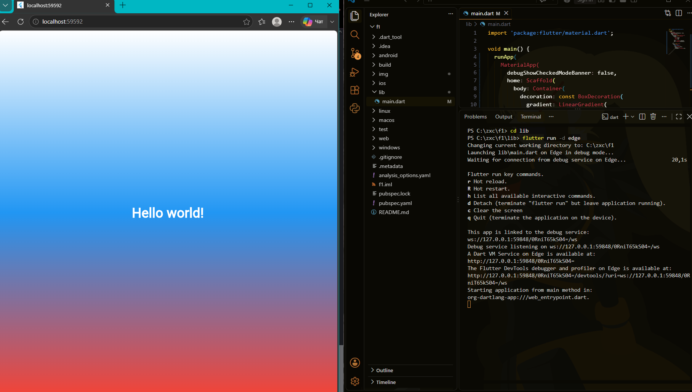

# Lab 3

## Автор
* **Имя:** Эсмира Исенбекова
* **Группа:** ИСП-241

## Стек и версии
* **Framework:** Flutter 3.x.x
* **Language:** Dart 3.x.x
* **Platform:** Web (Edge)
* **IDE:** Visual Studio Code (с плагинами Dart и Flutter)

## Результат работы приложения

## Запуск
1. Клонировать репозиторий: `git clone <ссылка_на_ваш_репозиторий>`
2. Перейти в папку проекта: `cd first_flutter_app`
3. Выполнить команду: `flutter pub get`
4. Запустить проект в браузере: `flutter run -d chrome`

## Что изучили
1. Познакомились с кроссплатформенным UI-фреймворком Flutter и языком программирования Dart.
2. Изучили базовую древовидную концепцию построения интерфейса (Widget Tree).
3. Научились использовать утилиты `Hot Reload` (для мгновенного обновления UI) и `Hot Restart` (для сброса состояния).
4. Освоили базовые виджеты разметки и стилизации: `MaterialApp`, `Scaffold`, `Container`, `Center` и `Text`.
5. Поработали с инструментами отладки интерфейса через `Flutter DevTools`.
